# 流程图与时序图（RSS 项目 puregamma-event-collector · market-report v2）

下面的图和代码一致，文中的周期和阈值都是线上实际使用的值。
Mermaid 源文件在 `diagrams/`，PNG 在 `diagrams-png/`。改了源文件后，运行 `python3 market/diagrams/render.py market/diagrams market/diagrams-png` 重新生成 PNG。
口径细节见 [DESIGN.md](DESIGN.md)，生成快照和异动的提示词见 [PROMPT.md](PROMPT.md)。

## 图 1 · 系统总览（流程图）

两个容器：market-report 是行情生产者，collector 负责 RSS 新闻和命令，两者通过只读的 SQLite 快照衔接；全部数据来自 Coinbase 和 Nasdaq 的公开接口。简报通过 Telegram 发送，也可以通过企业邮箱以 HTML 邮件发送。

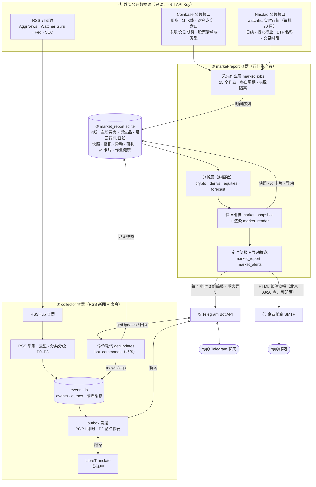

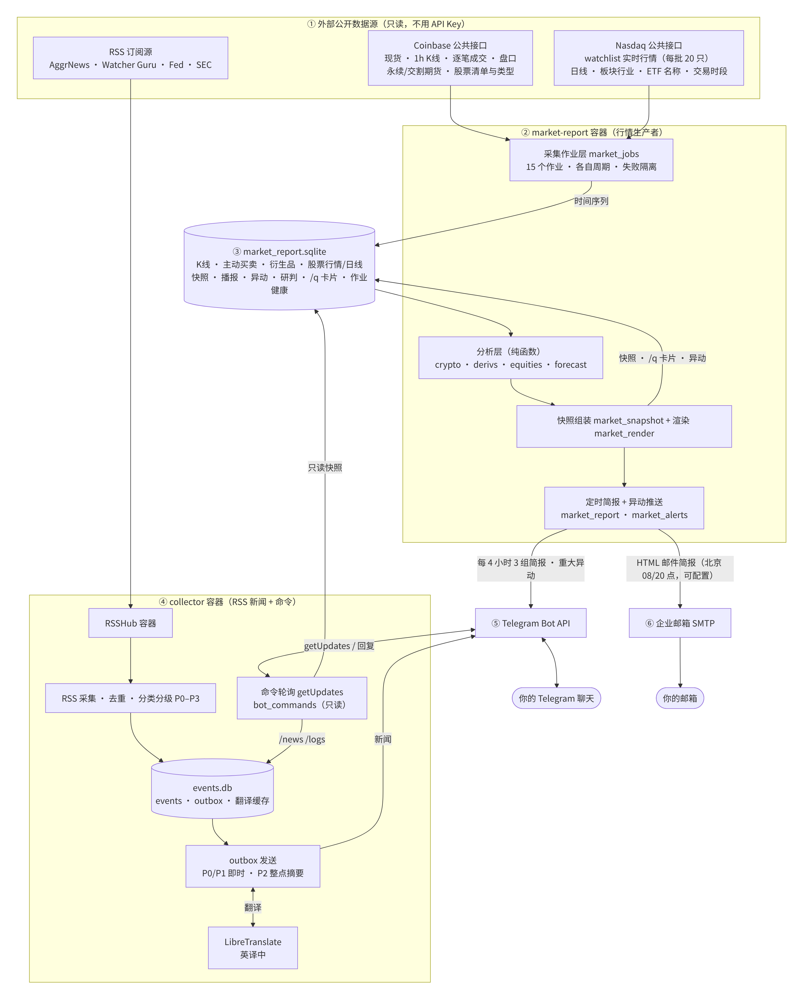

## 图 2 · 主循环：每 60 秒一轮（流程图）

先跑到期的采集作业，再判断本期简报要不要发：每期只发一次，失败后断点续发，宽限期快结束时发失败通知，过期的简报不补发。

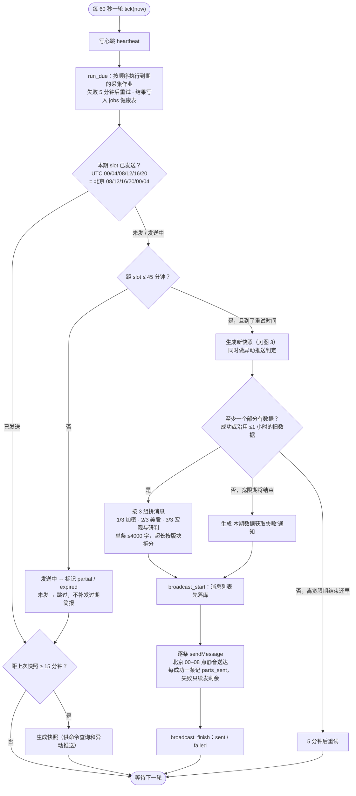

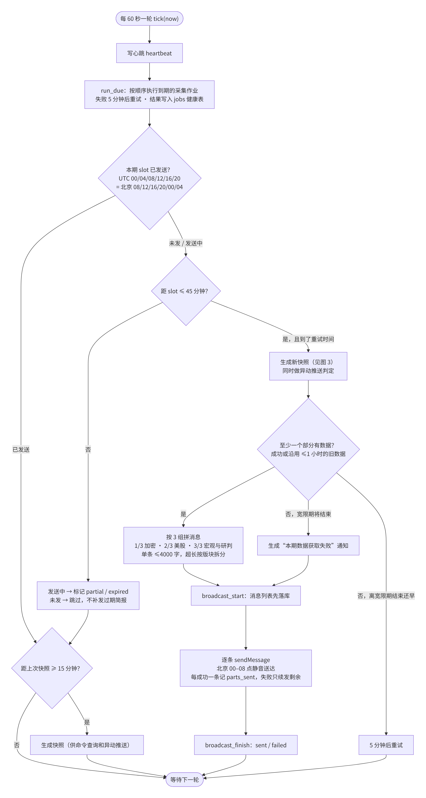

## 图 3 · 市场快照生成（流程图）

加密、衍生品与跨资产、美股、研判四个部分各算各的；哪部分失败了，就沿用它 1 小时内成功的旧数据，没有就显示“暂不可用”。

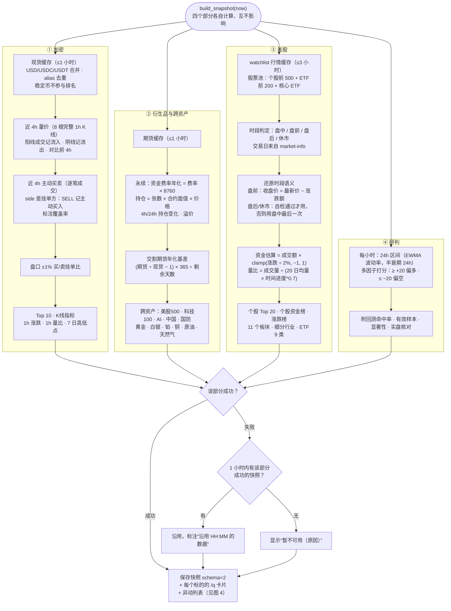

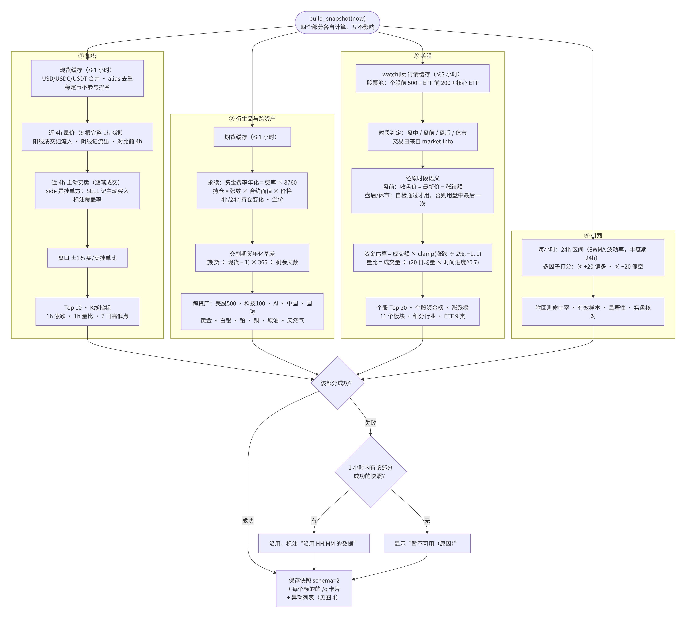

## 图 4 · 异动判定与推送（流程图）

每类异动的触发阈值和重大阈值（括号里）都写在图上。所有异动去重后入库，只有新出现的重大异动才推送：每天最多 8 条，夜间静音送达。

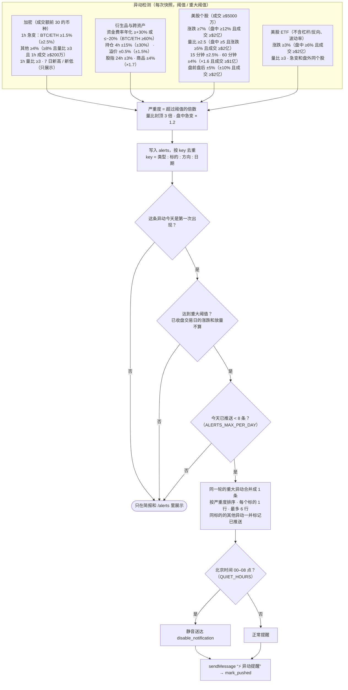

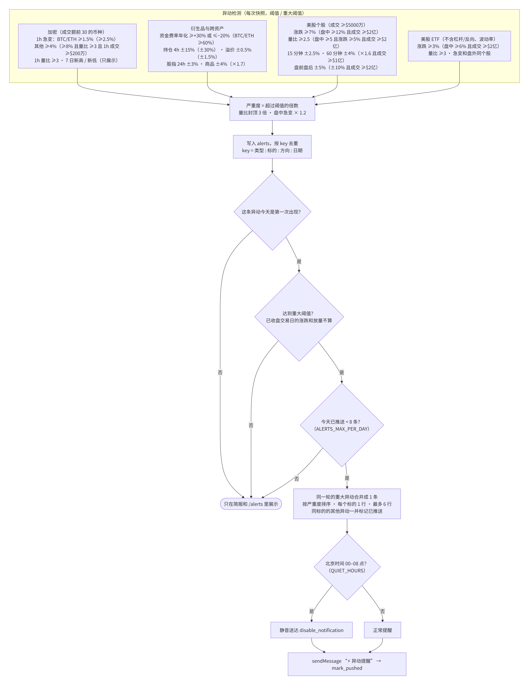

## 图 5 · 定时简报与异动推送（时序图）

一个简报时段内，采集作业、外部接口、数据库、快照组装、异动策略和 Telegram 之间的完整交互。

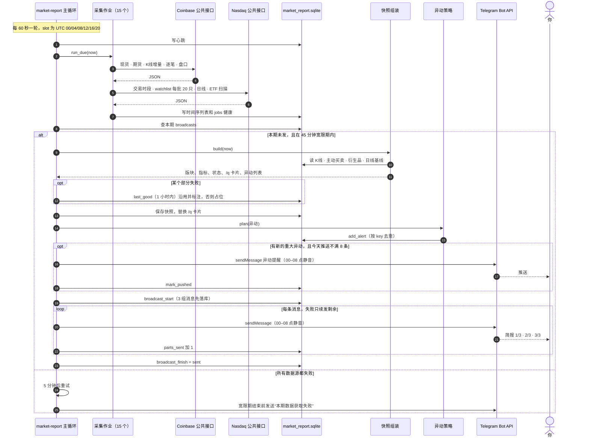

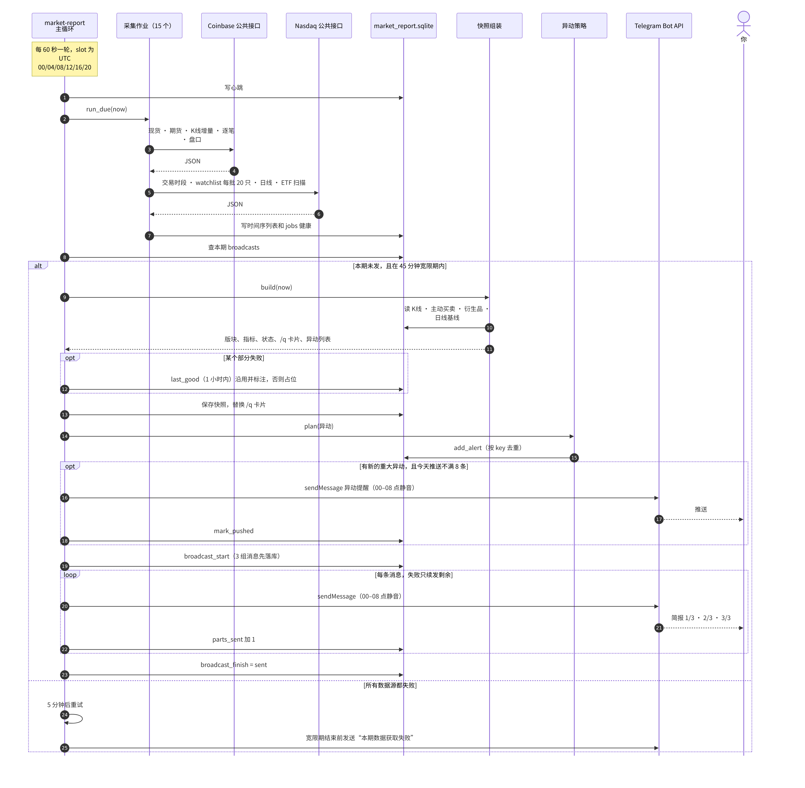

## 图 6 · Telegram 命令查询（时序图）

/market、/q 等命令由 collector 的轮询线程处理，只读快照；同一个 Bot 只能有一个程序接收消息。

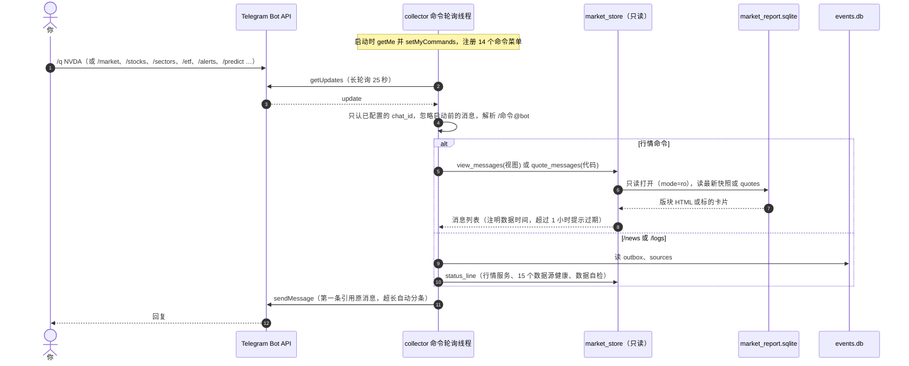

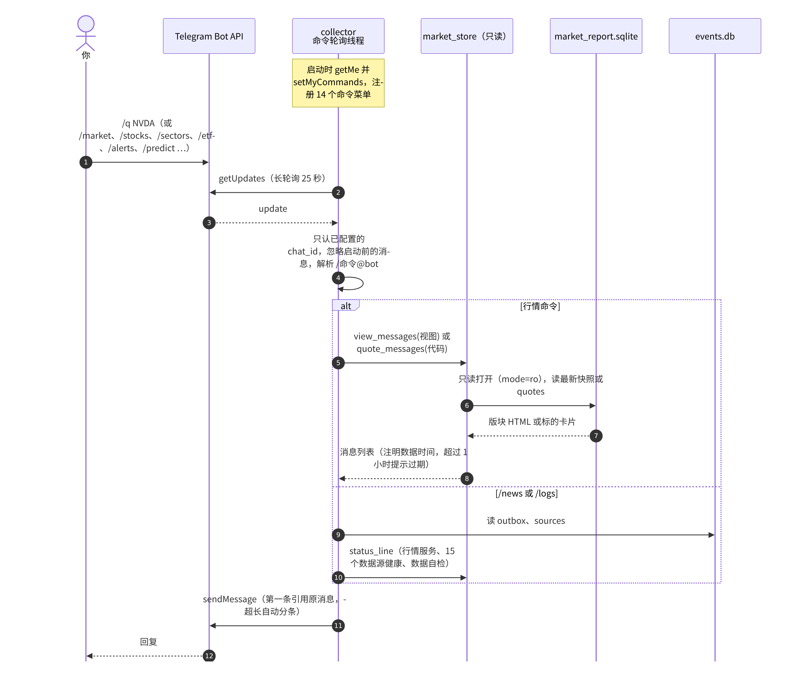

## 图 7 · RSS 新闻推送（时序图）

RSS 新闻原有的链路：去重、分级、翻译、发送。

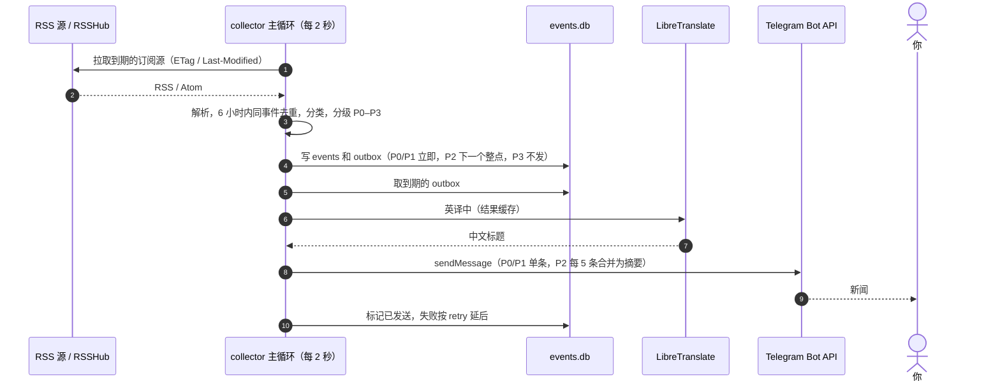

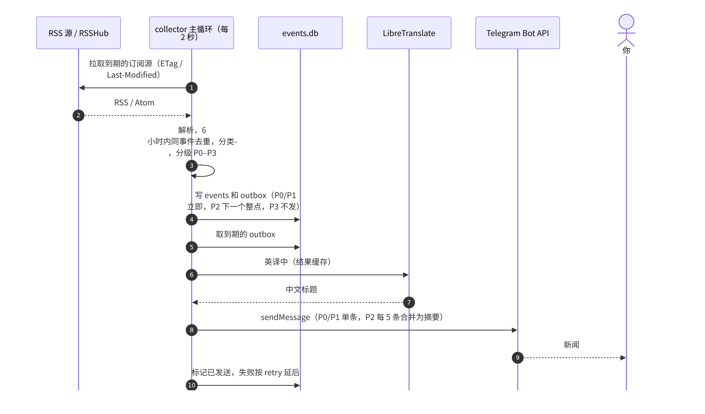
